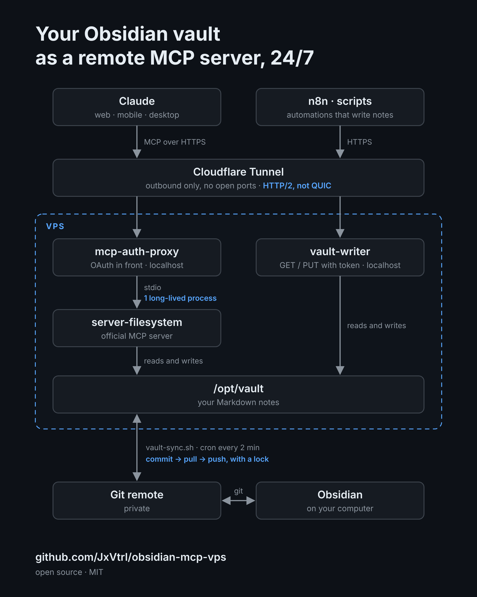

# obsidian-mcp-vps

Your Obsidian vault as a **remote MCP server**, online 24/7 on a cheap VPS.

Claude (web, desktop, mobile, Claude Code), ChatGPT, Cursor and any other MCP
client can read and write your notes from anywhere, even when your computer is
off. No ports opened, OAuth in front, vault kept in sync with git.

<p align="center">
  
</p>

## Why this exists

Most Obsidian MCP setups run on your laptop: they stop when the lid closes and
they don't work from your phone. Putting the vault on a server fixes that, but
the obvious way of doing it has sharp edges. This repo is the setup that
survived a few months of daily use, with the fixes baked in:

- **No 40-second cold starts.** A stdio-to-HTTP gateway that spawns a new
  server process per request will leak processes until the box swaps.
  Here the auth proxy owns one long-lived child. ([details](docs/troubleshooting.md#every-call-takes-30-40-seconds))
- **A sync script that doesn't silently die.** Commit before pull, a lock, and
  a loud failure on a stuck rebase. ([details](docs/troubleshooting.md#sync-stopped-and-nobody-noticed))
- **A tunnel that stays up.** HTTP/2 instead of QUIC. ([details](docs/troubleshooting.md#tunnel-drops-with-quic-errors))
- **Nothing listening on the public interface.** Everything binds to
  127.0.0.1 and leaves through an outbound Cloudflare Tunnel.

## What's in the box

| Piece | What it does |
|---|---|
| `docker-compose.yml` | [`@modelcontextprotocol/server-filesystem`](https://github.com/modelcontextprotocol/servers/tree/main/src/filesystem) behind [`sigbit/mcp-auth-proxy`](https://github.com/sigbit/mcp-auth-proxy) (OAuth 2.1 + password) |
| `scripts/vault-sync.sh` | Two-way git sync between the server and your vault's remote |
| `vault-writer/` | Optional. ~100-line HTTP `GET`/`PUT` endpoint so n8n, webhooks and scripts can write notes without speaking MCP |
| `systemd/vault-writer.service` | Sandboxed unit for the writer |
| `cloudflared/config.example.yml` | Tunnel ingress example |
| `install.sh` | Wires it all up |

This repo is glue and hard-won configuration. The MCP server and the auth
proxy are other people's excellent work; go star them too.

## Requirements

- A VPS with Ubuntu/Debian, Docker + compose plugin, git. 1 vCPU / 1 GB is plenty.
- Your vault in a **private** git repo (GitHub, Gitea, anything).
- A domain on Cloudflare (free plan) for the tunnel.
- Node 18+ on the host only if you want `vault-writer`.

## Setup

### 1. Get your vault into git

On your computer, the [Obsidian Git](https://github.com/Vinzent03/obsidian-git)
community plugin with auto commit/pull/push every couple of minutes is enough.
Use a private repo.

### 2. Give the server access to it

On the VPS, create a key and add the public half to the vault repo as a
**deploy key with write access**:

```sh
ssh-keygen -t ed25519 -f ~/.ssh/vault_deploy -N ""
cat ~/.ssh/vault_deploy.pub
```

### 3. Install

```sh
git clone https://github.com/JxVtrl/obsidian-mcp-vps.git
cd obsidian-mcp-vps
EXTERNAL_URL=https://mcp.example.com \
VAULT_REPO=git@github.com:you/your-vault.git \
./install.sh
```

> The compose stack and the sync script are what runs in production.
> `install.sh` is newer and has seen less testing: read it before running, and
> please open an issue if a step fails on your distro.

It clones the vault to `/opt/vault`, generates secrets into
`/opt/obsidian-mcp-vps/.env` (mode 600), starts the containers, installs the
sync cron and, unless `WITH_WRITER=0`, the writer service.

### 4. Route the tunnel

Create a tunnel in Cloudflare Zero Trust (Networks → Tunnels), install
`cloudflared` on the VPS with the command it gives you, and add a public
hostname:

| Hostname | Service |
|---|---|
| `mcp.example.com` | `http://localhost:8083` |
| `vault.example.com` (optional) | `http://localhost:8082` |

Force HTTP/2, see [troubleshooting](docs/troubleshooting.md#tunnel-drops-with-quic-errors).

### 5. Connect a client

The endpoint is `https://mcp.example.com/mcp`.

- **Claude**: Settings → Connectors → Add custom connector, paste the URL.
  A browser window asks for the `PASSWORD` from `.env`, once.
- **Claude Code**: `claude mcp add --transport http vault https://mcp.example.com/mcp`
- **Other clients**: anything that supports OAuth for remote MCP servers
  works the same way. There is no static-token access; a request without a
  valid OAuth token gets a 401.

Ask it to list your vault. That's it.

### 6. Lock the box

```sh
ufw default deny incoming && ufw allow OpenSSH && ufw enable
apt install fail2ban
ss -tlnp   # nothing but sshd should listen on 0.0.0.0
```

## vault-writer (optional)

For tools that speak HTTP, not MCP:

```sh
TOKEN=$(cut -d= -f2 /etc/vault-writer.env)

curl -X PUT https://vault.example.com/vault/Inbox/from-n8n.md \
  -H "Authorization: Bearer $TOKEN" \
  --data-binary "# Hello from a webhook"

curl https://vault.example.com/vault/Inbox/from-n8n.md \
  -H "Authorization: Bearer $TOKEN"
```

Paths that escape the vault or touch `.git` are rejected. Whatever it writes
is committed and pushed by the next sync run, and shows up in Obsidian a
couple of minutes later.

## Security notes

- An MCP client connected here can read, overwrite and delete any note. Treat
  the password like the vault itself, and keep the git history: it is your undo.
- The filesystem server sees only `VAULT_DIR`.
- Sync conflicts are rare with one human and one agent, but they happen. The
  script refuses to continue on a stuck rebase and says so in
  `/var/log/vault-sync.log`. Check it if notes stop arriving.

## Troubleshooting

See [docs/troubleshooting.md](docs/troubleshooting.md).

## License

MIT
